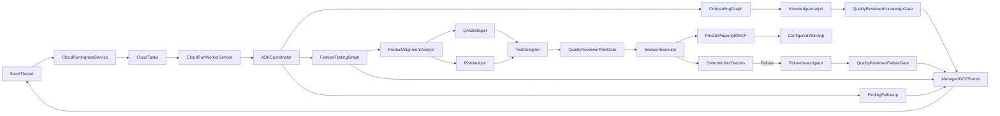

# Qali 2.0 Frontend Feature-Testing MVP

## Overview

Build Qali 2.0 as a production-shaped private MVP with one generic capability: a Slack-controlled, bounded multi-agent coordinator system that onboards one web project and autonomously tests one requested frontend feature at a time through isolated Playwright MCP. Use specialist agents inside a deterministic custom-logic workflow, progressive QA skills, test-driven development, durable project knowledge, bounded review gates, and final qualification with real Slack, the Gemini Developer API free tier, minimal GCP services, Playwright MCP, and SauceDemo integrations.

## Work status

- [ ] Create the approved Agents CLI foundation, coordinator workflow graph, typed specialist contracts, architecture records, CI checks, and initial repository baseline.
- [ ] Deliver the coordinator-led Slack-to-knowledge onboarding slice with the Knowledge Analyst, secure credentials, managed storage, bounded quality review, automated tests using test-only service doubles, and real-integration verification.
- [ ] Deliver the Product Alignment, QA Strategy, Risk, Test Design, Browser Execution, Failure Investigation, and Quality Review specialist flow; qualify it first with SauceDemo cart.
- [ ] Run live free-tier Gemini evaluations, private-deployment hardening, approved Cloud Run deployment, and deployed Slack/SauceDemo E2E verification without automatic paid-model fallback.

## Scope and acceptance boundary

- Qali has one generic capability: test one requested frontend feature per run. The feature name, scope, expected behavior, prerequisites, risks, and safe actions come from the natural-language request and project knowledge—not feature-specific application code.
- SauceDemo’s shopping cart is the first qualification and demonstration target. It must remain fixture/config data; no production domain, workflow, prompt, adapter, or storage path may depend on `cart`, SauceDemo selectors, its URL, or its credentials.
- Onboarding and issue follow-up are supporting paths, not additional product features.
- One Slack workspace and one designated project channel map to one Qali project and one target URL.
- During development and qualification, access is restricted to the owner in the private `#test-qali` channel through the existing Qali Slack app. Customer or public access requires a later explicit release decision and a fresh review of Gemini service terms, privacy, capacity, and paid-service requirements.
- Explicitly defer whole-application or multi-feature runs, API/mobile/desktop testing, GitHub/Jira connectors, multi-tenancy, cross-browser coverage, self-modifying harnesses, automatic permanent test-code generation, and non-Gemini providers.
- If a request names multiple features or an application-wide scope, Qali asks the Slack requester to choose one feature. It may autonomously include minimal prerequisite flows, such as login or navigation, while clearly keeping them outside the assessed feature scope.
- “Any feature” means a browser-accessible frontend feature that Qali can reach with the onboarded environment, credentials, knowledge, and project action policy. Consequential production actions remain denied unless project configuration explicitly provides a safe test path.

## Architecture decision

Use Google’s multi-agent coordinator pattern as the primary topology, implemented as a bounded custom-logic workflow:

1. A Slack-facing ADK coordinator interprets natural language, owns the request lifecycle, and routes only among `onboard_project`, `test_feature`, and `explain_finding`. It delegates typed tasks but does not improvise infrastructure or unrestricted agent-to-agent conversations.
2. Logical specialist agents provide isolated expertise: Knowledge Analyst, Product Alignment Analyst, QA Strategist, Risk Analyst, Test Designer, Browser Executor, Failure Investigator, and Quality Reviewer. They run together in one worker application deployment, not as independent microservices or A2A services. Slack ingress is a separate lightweight service so long browser jobs cannot block event acknowledgement.
3. Python application services and supported ADK workflow/custom-agent primitives own the deterministic graph: sequencing, safe parallel fan-out, conditional branches, persistence, retries, budgets, one-revision review limits, and exit conditions.
4. Use review-and-critique only at critical handoffs: compiled knowledge/product interpretation, strategy-risk-scenario package, and confirmed failure classification. Deterministic schema and oracle checks validate every handoff; not every step incurs another model call.
5. The Browser Executor alone uses bounded ReAct through Playwright MCP, with accessibility snapshots first, isolated Chromium contexts, step/time budgets, and harness-owned oracles. The model explores and acts; code decides pass/fail.
6. Use Pydantic schemas for every handoff (`ProjectContext`, `SourceRecord`, `ProductIntent`, `FeatureIntent`, `RiskAssessment`, `TestStrategy`, `TestScenario`, `Oracle`, `RunResult`, `FailureClassification`, `Finding`, `ReviewVerdict`, `AuditEvent`). Render human-readable Markdown from the same structured records.

This is not a swarm or hierarchical decomposition tree. The coordinator handles adaptive request routing, while the custom-logic graph prevents model-driven drift in the known QA lifecycle. The separation is by cognitive responsibility, not by product feature: cart, search, and profile testing reuse the same specialists.



### Specialist contracts and least privilege

- **Coordinator:** may read thread/session state and invoke named workflows; it cannot access source ingestion, secrets, storage primitives, or the browser directly.
- **Knowledge Analyst:** validates and compiles project sources with citations, contradictions, confidence, and explicit gaps; it cannot invent expected behavior or create test plans.
- **Product Alignment Analyst:** grounds the requested feature, user value, expected behavior, prerequisites, and scope against project knowledge; unresolved product ambiguity is surfaced rather than guessed.
- **QA Strategist:** defines the test mission, depth, coverage boundaries, assumptions, and stopping conditions from the product intent.
- **Risk Analyst:** independently identifies and prioritizes product, state, data, environment, concurrency, and usability risks so strategy does not anchor its assessment.
- **Test Designer:** synthesizes approved product intent, strategy, and risks into executable scenarios and deterministic positive/forbidden-state oracles.
- **Browser Executor:** receives only the approved plan, safe credential references, target policy, and browser facade. It explores and executes but cannot change expected results or mark its own work passed.
- **Failure Investigator:** receives failed observations and evidence, performs at most one fresh-context reproduction through the workflow, and classifies product defect, Qali/test defect, environment failure, flaky/inconclusive, or expected behavior.
- **Quality Reviewer:** uses a separate prompt/context to approve or return typed feedback at the three critical gates. It has read-only artifact access, no browser or mutation tools, and permits at most one revision before an explicit inconclusive/escalated result.

## Runtime components and boundaries

- Scaffold/enhance the existing repository with Agents CLI before agent code, preserving generated `agents-cli-manifest.yaml`, A2A/FastAPI wiring, Dockerfile, and deployment conventions. Keep Python 3.11+ and `uv`; Node exists only to run the official Playwright MCP server.
- Implement Slack with Bolt for Python and HTTP Events API in a lightweight Cloud Run ingress service. Verify signatures and timestamps, deduplicate `event_id`, acknowledge within three seconds, then enqueue work. The ingress service never starts agents or browsers. Use a single progressively updated bot message in the originating thread via `chat.update`; final and follow-up replies stay in that thread.
- Subscribe only to the designated channel. Process unmentioned replies only inside known Qali threads; ignore unrelated channel traffic.
- Run Cloud Tasks against an authenticated internal endpoint on a separate Cloud Run worker service. Use idempotency keys for Slack retries and task redelivery, project-level serialization, a 15-minute job budget, bounded model/browser steps, and graceful cancellation/failure states. Scale and configure ingress independently from browser workers.
- Keep every specialist invocation isolated to its minimum input schema, phase-specific instructions, and allowed tools. Persist typed handoffs and reviewer verdicts so the coordinator can resume without replaying hidden conversational context.
- Run Playwright MCP as a localhost-only child process in the Cloud Run container, not as a public endpoint. Pin its package/container version, use `--headless --isolated`, restrict target origins, disable unrestricted file access and vision by default, and set Cloud Run request concurrency to one per browser worker. The adapter owns session creation and cleanup.
- Put a deny-by-default browser facade in front of MCP. Expose only navigation, accessibility snapshot, role/ref actions, named credential fill, deterministic observation, and evidence capture; never expose raw credentials or unrestricted MCP tools to an agent.
- Keep credentials out of prompts and browser-agent context. During the private MVP, provision target credentials manually and directly in Secret Manager and expose only credential references to Qali. Defer the single-use, short-lived HTTPS credential form until customer onboarding is added; Slack has no true secret input, so secrets must never be pasted into Slack or chat.
- Use the Gemini Developer API free tier during development, debugging, evaluation, and private qualification. Store its API key in Secret Manager, select an available free-tier Flash model immediately before implementation, and pin its exact model ID in configuration and each runtime manifest. Apply strict request/token budgets, fail closed when free quota is exhausted, and never fall back automatically to paid quota or a paid model. Keep the provider behind ADK/model configuration so a later explicitly approved paid production service can replace it.

## Knowledge, memory, and artifacts

- Project data does not live in the Qali code repository. Store it in a versioned, access-controlled GCS project prefix; use isolated test fixtures only inside the automated test suite.
- Preserve four explicit layers:
  - `raw/`: immutable snapshots of Slack text, safe HTTPS pages, and MD/TXT/PDF uploads with hash, timestamp, source URI, and author/provenance.
  - `knowledge/`: Qali-compiled Markdown wiki with `index.md`, project/feature pages, source citations, assumptions, contradictions, and confidence. This is the operational source of truth; conflicts are resolved against immutable raw provenance.
  - `observations/`: append-only evidence, requester clarifications, discovered behavior, and run learnings. Observations can propose knowledge changes but cannot silently redefine expected behavior.
  - `derived/` and `runs/`: regenerated risks, charters, scenarios, plans/results, reports, traces, snapshots, screenshots, and issue evidence. Derived documents may never rewrite source facts.
- Use Firestore for project/channel mapping, jobs, idempotency, source metadata, issue status, artifact pointers, resumable Slack-thread context, and project-scoped clarification/decision indexes. Store canonical project knowledge and immutable artifacts in GCS. Do not use paid Agent Platform Sessions or Memory Bank in the private MVP; memory is a retrieval aid, never the source of truth.
- Adopt Karpathy’s compiled-wiki pattern: immutable raw sources, incrementally maintained Markdown knowledge, `index.md` for progressive disclosure, and a chronological log. Do not add embedding RAG in the MVP; add an ADR trigger to adopt managed Agent Platform Search only when corpus size or retrieval evals show the index/search approach is insufficient.
- Store operational JSON and human-readable Markdown together. Use immutable per-run audit events rather than fragile concurrent appends, then materialize `logs/testing-log.md` and `issues/index.md` projections.
- Retain project sources and compiled knowledge until the project is deleted; run reports and structured results for 90 days; screenshots, traces, and browser evidence for 30 days; redacted audit events for 90 days; and secrets until rotation or explicit deletion. Delete failed or abandoned uploads within 24 hours. Enforce these periods with lifecycle policies and deterministic cleanup jobs.

Planned storage layout:

```text
projects/{project_id}/
  raw/{source_id}/...
  knowledge/index.md
  knowledge/project.md
  knowledge/features/{feature_slug}.md
  knowledge/assumptions.md
  observations/{observation_id}.md
  derived/{feature_slug}/risk-assessment.md
  derived/{feature_slug}/test-charter.md
  derived/{feature_slug}/scenarios.json
  runs/{run_id}/request.md
  runs/{run_id}/plan.json
  runs/{run_id}/result.json
  runs/{run_id}/report.md
  runs/{run_id}/evidence/...
  issues/{finding_id}.md
  logs/testing-log.md
```

## QA harness and execution quality

- Treat existing [.agents/skills](.agents/skills) as the authoring-time expert corpus. Do not ship the full library or the stale catch-all `qa-do` router in runtime context.
- Build a minimal runtime harness under [harness/skills](harness/skills) organized by specialist responsibility: project context, product alignment, QA strategy, risk analysis, test design, agentic browser execution, oracle evaluation, failure reproduction/classification, and quality review. Distill the relevant QA corpus into phase-specific contracts instead of loading full skill bodies.
- Keep project bootstrap, suite audit, selector repair, dashboards, release-readiness, and permanent test-code authoring skills development-only. Their outputs may feed runtime project context, but their instructions do not enter each run.
- Implement progressive disclosure per specialist: load only that role’s compact playbook and current typed inputs. Do not share the full thread, full knowledge base, other specialists’ hidden reasoning, or all tools with every agent.
- The QA Strategist and independent Risk Analyst must cover nominal, boundary, negative/error, state transition, repeated/idempotent, rapid-action, multi-tab/concurrency, accessibility-tree, and environment concerns. They record “not applicable” with a reason instead of manufacturing irrelevant tests; the Test Designer must trace each scenario to approved product intent or risk.
- Every scenario declares setup, user intent, step budget, deterministic positive oracle, forbidden-state oracle, cleanup, and evidence policy. The harness—not the LLM—decides pass/fail from URL, accessibility-tree state, counts, console/network errors, and other typed observations.
- Report honest counts: scenarios and checks, not an inflated “tests” number. Happy results stay minimal; failures list finding IDs and short descriptions.
- On failure, rerun once in a fresh isolated context. A reproducible failure becomes a finding; a non-reproducible failure is marked inconclusive/flaky and is not presented as a confirmed product bug. Capture trace, accessibility snapshot, console/network evidence, and screenshot on the failure path so later Slack follow-ups do not need to repeat the original run.

## Security, observability, and audit

- Apply least-privilege service accounts and secret-level access; never commit `.env`, Slack tokens, Gemini keys, test passwords, browser storage state, signed URLs, or project artifacts.
- Validate HTTPS source URLs and redirects; deny private, loopback, link-local, metadata, and non-approved origins to limit SSRF. Apply file type/size/count limits and malware/injection screening before ingestion.
- Treat web pages, uploaded documents, browser text, and subagent output as untrusted data. Fence it from instructions, schema-validate agent handoffs, block instructions embedded in sources, and test indirect prompt injection and exfiltration fixtures.
- Give runtime agents no general shell, host filesystem, deployment, Git, or arbitrary network tools. The browser action policy permits only the configured target origin and project-approved actions. It denies unrelated navigation and consequential operations not explicitly marked safe for the target environment.
- Use Cloud Trace and structured Cloud Logging with correlation IDs and content capture disabled. Keep complete but redacted domain audit records in project artifacts: request reference, decisions, tool/action names, result references, revisions, and reasons—never secret values or raw credential-bearing payloads.
- Record a runtime manifest on every run: exact model ID, prompt/workflow version, runtime-skill hashes, MCP version, and application commit SHA. Reject unapproved drift rather than silently changing the testing harness.
- Maintain Qali’s own [docs/development-log.md](docs/development-log.md) with datetime, isolated change, and reason; update [docs/user-guide.md](docs/user-guide.md) whenever behavior changes. Git commits remain the authoritative system-development history.

## Planned repository structure

- [app/agent.py](app/agent.py): Slack-facing ADK coordinator and three-workflow routing surface.
- [app/agents](app/agents): isolated specialist definitions, phase prompts, input/output schemas, tool allowlists, and quality-review criteria.
- [app/fast_api_app.py](app/fast_api_app.py): generated serving surface plus Slack/internal routes through supported extension points.
- [app/domain](app/domain): typed models, policies, states, and result schemas with no external I/O.
- [app/services](app/services): deterministic onboarding and feature-testing workflow graphs, specialist invocation, review gates, finding follow-up, and audit projection.
- [app/adapters/slack](app/adapters/slack): signature verification, events, views/buttons, progress updates, and thread/session mapping.
- [app/adapters/browser](app/adapters/browser): restricted Playwright MCP facade, lifecycle, isolated sessions, named credential injection, observations, oracles, and evidence export.
- [app/adapters/storage](app/adapters/storage): GCS, Firestore-backed durable session/decision indexes, and Secret Manager implementations behind protocols.
- [harness](harness): progressive skill index, QA playbooks, workflow rules, prompts, schemas, and runtime manifest; no project-specific data.
- [tests/unit](tests/unit), [tests/integration](tests/integration), [tests/contract](tests/contract), [tests/e2e](tests/e2e), and [tests/eval](tests/eval): deterministic code tests with test-only doubles, adapter contracts, real-integration E2E journeys, and ADK behavioral evals.
- [docs/architecture.md](docs/architecture.md), [docs/adr](docs/adr), [docs/user-guide.md](docs/user-guide.md), and [docs/development-log.md](docs/development-log.md): maintained design and operation records.

## TDD and verification strategy

Follow vertical red-green-refactor slices: one observable behavior test, minimal implementation, green verification, then refactor. Pytest validates deterministic code and boundaries; Agents CLI eval validates nondeterministic agent behavior. Never assert prose LLM output in pytest.

- Unit: coordinator routing, workflow transitions, specialist schemas/tool allowlists, review/revision limits, scope/action policy, URL validation, redaction, risk coverage, oracles, failure classification, finding fingerprints, and audit projection.
- Integration: use test-only doubles for Slack, Cloud Tasks, Firestore/GCS/Secret Manager, specialist model decisions, and Playwright MCP responses to verify isolated contexts, typed handoffs, strategy/risk fan-out and synthesis, review feedback, resume behavior, retries, idempotency, progress updates, and failure paths.
- Contract: validate Slack payload schemas and pinned Playwright MCP tool responses independently of Gemini; run selected sandbox/live contract checks before release.
- Add at least two unrelated synthetic feature fixtures, such as profile editing and catalog filtering, and run both through the application-service workflow in tests. This is the architectural check that feature names, selectors, routes, or expected outcomes are not hardcoded.
- ADK eval: evaluate each specialist’s grounded output and the complete coordinator trajectory for missing onboarding, varied feature requests, product alignment, risk completeness, ambiguity, prerequisite handling, scenario traceability, browser tool safety, failure-triage accuracy, reviewer independence, concise results, grounded follow-up, and injection resistance. Keep held-out cases for the final gate.
- Integration progression: use test-only model and browser doubles while scaffolding deterministic services; then connect real Playwright MCP to SauceDemo with scripted plans; then enable live Gemini; finally run deployed Slack-to-browser E2E through real GCP services. Require two clean isolated cart runs and one intentionally failing oracle path with preserved evidence.
- PR checks run lint/format/type checks, unit/integration/contract tests, secret scanning, dependency/container checks, and stable eval subsets that do not require external credentials. Real-integration gates run in an approved environment before release. Deployment remains a manual `agents-cli deploy` action after explicit approval.
- Deterministic tests, schema checks, policy checks, and security probes require 100% pass with zero secret leakage or forbidden tool/action violations. Core ADK behavioral evaluations require at least 90% in two consecutive runs; held-out evaluations require at least 85% with no critical safety or grounding failure. Any regression in a previously passing critical case blocks release.

## Execution sequence and PR gates

### Pre-execution decision interview

- Before bootstrap or scaffolding, inspect what can be determined safely from the repository and connected accounts, then ask the user only for unresolved decisions. Ask one question at a time and wait for the answer before asking the next.
- Confirm the public Slack interface and highest-priority observable behaviors for the first TDD tracer bullets.
- Confirm the GCP organization/account, project ID, billing status, region, resource-name prefix, budget, and who may approve resource creation. Use the Gemini Developer API free tier for the private MVP unless the user explicitly approves a paid service later.
- Confirm the Slack workspace, designated project channel, Slack app ownership/configuration, and externally reachable HTTPS domain for the single-use credential form. Never ask the user to paste secret values into chat.
- Confirm the first target environment, allowed origins/actions, test-data reset policy, and how credential references will be provisioned. SauceDemo remains qualification data rather than production logic.
- Agree measurable ADK eval thresholds, deterministic release gates, retention/redaction periods, and the human approvers for remote-main replacement, integration resource creation, and production deployment.
- Materialize the approved answers in [.agents-cli-spec.md](.agents-cli-spec.md), self-review it, and obtain explicit approval before running any scaffold, cloud-resource, or implementation command.

Approved private-MVP configuration:

- GCP project `qali-507317` (project number `104724129371`), billing enabled, standard region `europe-west1`, with a 100 SEK monthly alert budget as the absolute owner-defined financial boundary.
- One GCP project only. Keep pre-release resources minimal, labeled, scale-to-zero, and isolated by resource name; do not create a second environment project.
- Gemini Developer API free tier only during development and private qualification. Exhausted quota stops work cleanly; paid activation or fallback requires the owner’s explicit approval.
- Existing Qali Slack app and private `#test-qali` channel; access restricted to the owner for now.
- Onboarding sources: Slack text/clarifications, approved HTTPS URLs, and MD/TXT/PDF uploads.
- Project-agnostic deny-by-default action policy: onboarding supplies origins, credential references, allowed action categories, consequential-action denials, test-data rules, and cleanup. SauceDemo/cart details exist only in qualification fixtures.
- Target credentials are provisioned manually in Secret Manager during the private MVP; the public single-use credential form is deferred.
- The owner is the sole approver for remote-main replacement, cloud-resource changes, deployment, paid usage, and access expansion.

### Mandatory Agents CLI and ADK skill protocol

The installed Google Agents CLI skills are mandatory executable process instructions, not optional reading. Re-read the relevant skill immediately before each phase because conversation compaction or handoff may remove prior context. Current installed skills and exact CLI/package behavior override secondary articles or remembered APIs.

1. **Understand:** load `google-agents-cli-workflow`; materialize this approved design in [.agents-cli-spec.md](.agents-cli-spec.md), self-review it, and obtain user approval before scaffolding.
2. **Study recipes:** load `google-agents-cli-adk-code`, inspect `references/samples.md`, and study the exact official recipes matching multi-agent context isolation, graph workflows, cross-session memory, guardrails, credentials, and event-driven execution. Record what is reused and what is deliberately adapted; do not reimplement a matching recipe from memory.
3. **Scaffold:** load `google-agents-cli-scaffold`, run `agents-cli info`, then enhance the existing repository. Preserve generated manifest, FastAPI, A2A, Docker, eval, and deployment conventions; never hand-write generated A2A plumbing.
4. **Build:** reload `google-agents-cli-adk-code`; inspect `references/adk-python.md`, `references/adk-workflows.md`, and installed ADK source for exact signatures before implementing the coordinator, specialist agents, tools, callbacks, state, artifacts, or workflow graph. Use `agents-cli run` only for smoke checks.
5. **Evaluate:** load `google-agents-cli-eval` before creating or running evaluations. Use pytest only for deterministic code/contracts and `agents-cli eval run` for multi-agent behavior, trajectory, tool use, grounding, safety, and final-response quality. Inspect scores rather than relying on exit code; preserve held-out cases and show evidence before deployment.
6. **Deploy:** load `google-agents-cli-deploy`; confirm current target/configuration with `agents-cli info`, use generated deployment flow and Terraform for production resources, present test/eval evidence, and obtain explicit user approval before `agents-cli deploy`.
7. **Observe:** load `google-agents-cli-observability`; verify Cloud Trace spans for coordinator, specialist, model, and tool calls, plus redacted logging and runtime metrics after deployment.
8. **Publish:** use `google-agents-cli-publish` only if Gemini Enterprise registration is explicitly added later; it is not part of this MVP.

At every phase boundary, add the skill/version used, official recipe or reference consulted, commands run, evidence produced, and deviations with rationale to the development log. Stop the phase if a required skill, recipe, generated file, eval result, or approval is missing.

### Bootstrap baseline

- Treat the empty local `main` working tree as the user-authorized Qali v2 source baseline. Do not restore, inspect for product requirements, merge, or copy implementation from the legacy codebase.
- Preserve `.git`: it contains the remote configuration, legacy reference, and linked-worktree metadata required for a safe transition. Do not delete or reinitialize it merely because local `main` is unborn.
- Before replacing remote `main`, verify that the current remote-main tip is preserved by `v1-legacy`, resolve both exact SHAs, and abort if the remote changed after verification. Create the initial v2 baseline commit on local `main`, then update `origin/main` with a SHA-pinned `--force-with-lease`; never use an unguarded force push. This is the user-authorized bootstrap exception before PR-based work.
- Verify the uncommitted skill corpus, provenance, and licensing before including it in the baseline. Do not commit a skill with unresolved usage rights.
- Write and approve [.agents-cli-spec.md](.agents-cli-spec.md), run `agents-cli info`, and use `agents-cli scaffold enhance . --prototype --agent-directory app --agent-guidance-filename AGENTS.md` because the existing repository already contains the QA skills.
- Add repository rules, `.gitignore`, an ADR recording the coordinator/custom-logic decision and rejected alternatives, typed specialist contracts, workflow skeleton, documentation/log templates, adapter protocols, production integration configuration, and the minimal GitHub PR-check workflow.

### PR 1: Slack job and onboarding slice

- Implement the separate signed Slack ingress and authenticated worker services, coordinator, three-second acknowledgement, Cloud Tasks enqueue/idempotency, same-thread progress updates, onboarding graph, Knowledge Analyst, knowledge quality gate, safe source adapters, one-time credential capture, and production storage adapters.
- Extend the generated Terraform in this PR with the minimum approved integration resources needed to verify the slice in `qali-507317`: scale-to-zero ingress and worker Cloud Run services, Cloud Tasks, Firestore, GCS, Secret Manager, lifecycle rules, budget-aware quotas, and least-privilege service accounts/IAM. Do not add Agent Platform Sessions or Memory Bank. Create resources only after presenting the plan and receiving explicit approval.
- Use test-only service doubles during TDD, then verify the onboarding path with real Slack and the PR 1 GCP integration environment. Do not defer infrastructure required by this acceptance gate to a later PR.
- Gate on duplicate Slack delivery, unsafe URL/file rejection, no-secret logging, insufficient-knowledge warning, and project-ready acceptance tests.

### PR 2: Generic feature-testing slice

- Implement the Product Alignment Analyst, QA Strategist, independent Risk Analyst, Test Designer, Browser Executor, Failure Investigator, and Quality Reviewer inside the generic feature-testing graph, including prerequisite isolation, typed handoffs, bounded reviews, deterministic oracles, failure fingerprinting, artifact persistence, concise Slack results, and finding follow-up.
- Keep all production paths parameterized by `project_id`, `feature_slug`, project knowledge, target URL, credential reference, and action policy. Add a static check/test that rejects SauceDemo- or cart-specific constants outside fixtures and qualification data.
- Build deterministic services with test-only LLM and browser doubles, prove the same service workflow with two unrelated synthetic fixtures, then remove those doubles from all runtime composition and verify a deterministic real-browser SauceDemo cart qualification run before enabling the live model.

### PR 3: Production integration and release slice

- Add qualified live Gemini Developer API free-tier configuration and ADK eval-fix iterations; harden injection, free-quota exhaustion, request/token budgets, timeout, retry, concurrency, and redaction behavior.
- Run `agents-cli scaffold enhance . --deployment-target cloud_run --cicd-runner skip`, then promote and harden the generated Terraform and PR 1 modules for the private deployment. Use Firestore/GCS durability, scale-to-zero settings, retention/alerts, and least-privilege IAM without recreating resources ad hoc or abandoning generated infrastructure conventions.
- Build the Chromium/MCP-capable container, scan it, deploy manually only after presenting all test/eval evidence and receiving explicit approval, then run the full Slack onboarding/feature-test/follow-up E2E against the deployed branch using SauceDemo cart as the qualification target.
- Verify Cloud Trace, redacted logs, durable artifacts, restart/session recovery, Slack retry idempotency, rollback procedure, and post-deployment smoke checks.

## Execution rules

- Work on one branch/PR at a time; do not begin the next PR until the previous PR is approved and merged by someone else. Never self-merge. Check and resolve reviewer comments, rerun all affected checks, and request review again.
- Use the required PR template sections: Summary of Changes, Technical Implementation, Verification & Testing, Risk & Breaking Changes, and Related Issues. Do not claim tests passed without command/eval evidence.
- Commit every completed red-green-refactor slice with a scoped, descriptive message; never bundle unrelated files, never create empty commits, and update the development log/user documentation in the same behavior-changing commit when required.
- Keep generated Agents CLI files intact, use `uv` for Python commands/dependencies, pin external protocol/runtime versions, and stop to diagnose repeated failures rather than retrying blindly.
- Never commit or paste secrets. Never deploy, create cloud resources, push a first remote branch, or open/merge a PR without the corresponding explicit authorization required by the execution environment.
- At each PR and milestone, perform a scope check: does this directly enable onboarding, generic one-feature-at-a-time frontend testing, result explanation, or production reliability for those paths? If not, defer it.

## MVP completion criteria

- A Slack user can mention Qali, securely onboard a web application, and see the project become ready in the same thread.
- `@Qali test the <feature> feature` resolves that feature from natural language and project knowledge, creates a reviewed risk-based plan, runs isolated browser scenarios with hard oracles, returns concise scenario/check statistics, and persists every run artifact.
- Every run records which specialists executed, their typed handoffs, reviewer decisions, workflow version, and deterministic verdict inputs without exposing hidden reasoning or secrets.
- The same application-service workflow passes tests for at least two unrelated synthetic feature fixtures; production code contains no SauceDemo/cart routes, selectors, credentials, expectations, or branches.
- A confirmed failure has a stable ID, one-line Slack summary, reproducible evidence, and an accurate follow-up report with steps, expected/actual behavior, and evidence reference.
- Firestore-backed short-term thread context survives Cloud Run restarts; project knowledge and explicit decisions are available in later threads through Firestore/GCS indexes without treating retrieved memory as authority.
- Only production integrations are runtime-composable; test doubles and fixtures remain confined to test code.
- Deterministic suites, no-hardcoding checks, contract tests, held-out ADK evals, security probes, two isolated SauceDemo cart qualification runs, deployed real Slack/Gemini/GCP/Playwright E2E, observability checks, and rollback smoke checks all meet their recorded gates.
