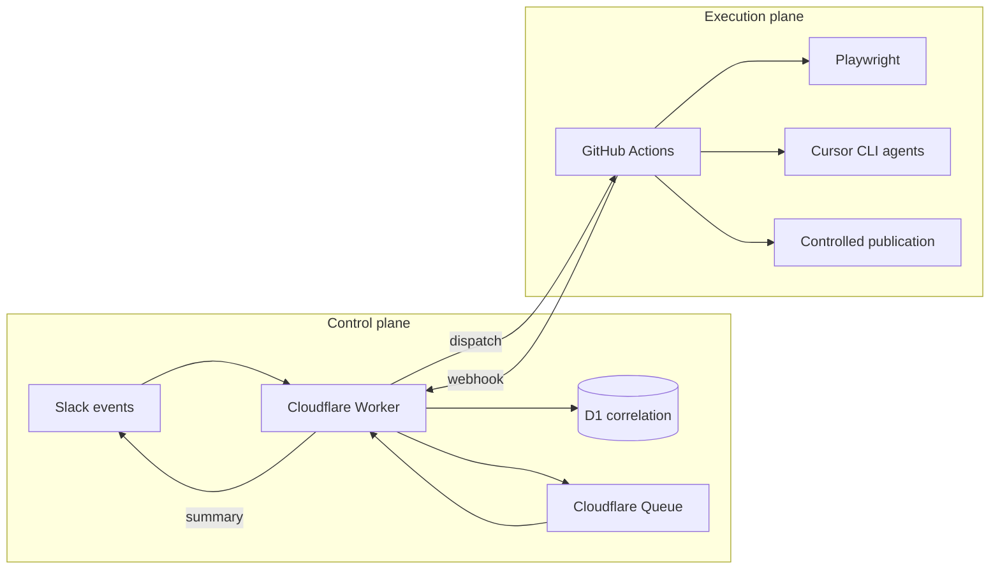

# Architecture

Qali separates **control** (fast, always-on intake) from **execution** (long-running Playwright and agent work).

## Planes

### Control plane (`apps/slack-worker`)

- Verifies Slack and GitHub webhook signatures
- Maps product-channel users to **Developer** and maps break-glass users in `#qali-ops` (`SLACK_OPS_CHANNEL_IDS` + `SLACK_QA_LEAD_USER_IDS`) to ops maintenance
- Enforces allowlists (`SLACK_ALLOWED_USER_IDS`, team, channel)
- Deduplicates and correlates requests in D1
- Classifies free-form text into normalized intents (Workers AI in production; deterministic fake in tests)
- Answers `query-project` questions from a D1 quality snapshot without GitHub Actions or Playwright
- Rejects unauthorized commands **before** queue dispatch
- Dispatches `execute.yml` through a least-privilege GitHub App

### Execution plane (`.github/workflows/execute.yml`)

Two jobs with isolated permissions:

1. **`validate-and-execute`** — `contents: read`. For work intents, runs `npm run check`, executes the requested workflow, validates project state, and prepares a publication manifest and patch artifact. `query-project` skips Playwright, Cursor, the repository check, and publication; it only reads the project pack and writes a quality snapshot.
2. **`publish-generated-changes`** — runs only when `QALI_PUBLISH_GITHUB_TOKEN` is configured and the intent is not `query-project`. Creates a `qali/*` branch, commit, and ready PR. Never pushes directly to `main`. The authoring job never reviews, approves, or merges that PR.

### Packages

| Package                | Role                                                          |
| ---------------------- | ------------------------------------------------------------- |
| `@qali/contracts`      | Zod schemas for intents, roles, workflows, Slack correlation  |
| `@qali/knowledge`      | Provenance, mutation classification, project scaffolding      |
| `@qali/orchestrator`   | Workflow validation, routing, step execution                  |
| `@qali/agent-runtime`  | Cursor CLI adapter (sandboxed)                                |
| `@qali/browser-facade` | Restricted local MCP browser and secret-safe evidence         |
| `@qali/playwright`     | Test runner and JSON report parsing                           |
| `@qali/reporting`      | Slack Block Kit summaries, hosted HTML reports, Markdown/JSON |
| `@qali/publication`    | Safe auto-commit policy and GitHub adapter                    |

Agent judgment runs in a per-step [runtime harness](runtime-harness.md) assembled from reviewed skills and explicitly selected inputs. The staged workspace is read-only except for declared outputs; Cursor has no shell tool and receives only the restricted browser MCP when a profile requires interactive exploration.

## Knowledge model

Three artifact classes with strict ownership:

- **Sources** — governed facts, risks, decisions, autonomy policy
- **Observations** — exploration findings and evidence (append-only with provenance)
- **Derived** — scenarios, reports, tasks, workflow state (regenerated by Qali)

Workflows in `workflows/` declare which internal role may read/write each class. External Slack roles gate _which workflows_ a user may trigger.

## Internal roles (invisible)

| Role              | Responsibility                      |
| ----------------- | ----------------------------------- |
| Intake Planner    | Normalize requests, pick project    |
| Knowledge Curator | Maintain sources and observations   |
| Test Architect    | Scenarios and coverage maps         |
| Explorer          | Exploratory testing with Playwright |
| Test Generator    | Specs from approved scenarios       |
| Executor          | Run suites, collect evidence        |
| Failure Analyst   | Triage and reproduction             |
| Suite Maintainer  | Self-healing equivalent repairs     |
| Reporter          | Compact Slack + detailed Markdown   |

## Live target and local fixture

The live Slack registry points at `projects/sauce-demo` (`https://www.saucedemo.com`). `projects/_demo` remains a credential-free Vitest and `npm run demo:loop` fixture; it is not a Slack product path.

## Deployment status

The Slack Worker and GitHub Actions path are deployed for this repository. Follow [setup-slack.md](setup-slack.md) and [setup-github.md](setup-github.md) to reprovision credentials. See [current-status.md](current-status.md) before treating any workflow as live-verified.
