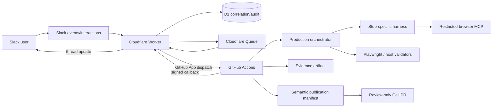

# Qali developer and operator guide

This guide is for the engineer, QA architect, or SDET who develops, operates, audits, or troubleshoots Qali. It explains not only the components, but the decisions behind them and the failure modes discovered while taking the system from a local QA scaffold to a live Slack → Cloudflare → GitHub Actions release candidate.

## 1. System purpose and design boundary

Qali is a Slack-first autonomous QA orchestrator. Slack is intentionally a thin, familiar interface over a governed internal QA system.

The internal system retains the useful parts of an IDE-centric QA harness—roles, skills, policies, workflow definitions, artifact ownership, validators, Playwright, and maintenance rules—without exposing that complexity to Slack users.

The primary design boundary is:

- AI performs bounded judgment: discovery, exploration framing, test authoring, explanation, repair proposals, and presentation.
- Deterministic host code performs execution, state transitions, fingerprinting, Playwright, validation, policy decisions, factual aggregation, and publication.
- No model claim is treated as proof. Observable artifacts and validators establish success.

## 2. Runtime topology



### Why split control and execution planes?

Slack expects fast acknowledgement; Playwright and agent work can take minutes. The Cloudflare Worker is the always-on control plane for signatures, authorization, deduplication, rate limits, queueing, correlation, and status updates. GitHub Actions is the disposable execution plane with repository access, browser dependencies, artifacts, environment isolation, and reviewable run history.

Do not move long-running execution into the Worker. Do not give the Actions execution job control-plane credentials it does not need.

## 3. Repository structure

| Area                       | Responsibility                                                                                 |
| -------------------------- | ---------------------------------------------------------------------------------------------- |
| `apps/slack-worker/`       | Slack/GitHub callbacks, D1, Queue, authorization, rate limiting, privacy, dispatch             |
| `packages/contracts/`      | Zod schemas for projects, commands, workflows, attempts, evidence, qualification, publication  |
| `packages/project-config/` | Trusted project/profile resolution after untrusted classification                              |
| `packages/orchestrator/`   | Workflow loading, dependency/runIf logic, retries, state, substantive workflow implementations |
| `packages/agent-runtime/`  | Harness assembly, Cursor adapter, qualification identity and policy                            |
| `packages/browser-facade/` | Restricted Playwright service and MCP boundary                                                 |
| `packages/playwright/`     | Deterministic test execution and report parsing                                                |
| `packages/knowledge/`      | Project pack validation, ownership, provenance, generated markers                              |
| `packages/publication/`    | Semantic diff classification, policy, GitHub publication adapter                               |
| `packages/reporting/`      | Slack Block Kit summaries plus hosted HTML reports (Markdown/JSON remain machine truth)        |
| `workflows/`               | Versioned workflow graph and step contracts                                                    |
| `harness/profiles.json`    | Exact skills, policies, tools, outputs, mutations, validators for each step                    |
| `skills/runtime/`          | Reviewed, pinned, licensed runtime instructions                                                |
| `projects/registry.json`   | Trusted project ID → root/environment/Slack/publication/profile mapping                        |
| `projects/<id>/`           | Governed project pack, observations, derived state, Playwright tests                           |
| `qualification/`           | Evaluation suite and version-controlled runtime qualification records                          |

## 4. Trust model and data ownership

### 4.1 Untrusted intake, trusted resolution

Slack text is untrusted data. The classifier may emit only:

- Intent
- Project ID
- Declarative focus parameters

After classification, `@qali/project-config` resolves the canonical root, GitHub Environment, Slack scope, publication repository, enabled workflows, schedule, and execution profile from trusted configuration. Never accept a path, target URL, permission, environment, autonomy mode, or publication destination from model output or user text.

The Workers AI classifier uses a strict JSON schema. A deterministic heuristic fallback preserves intake availability, but both routes feed the same trusted resolver and authorization checks.

Questions about status, last run, coverage, schedule, expected results, history, journeys, or known issues classify as `query-project`. The Worker answers from a D1 quality snapshot when one exists. If the snapshot is missing, Actions runs a host-only pack read with no Playwright, Cursor, or publication. Imperative run, explore, generate, triage, onboard, maintain, and quality-pulse requests remain work intents.

### 4.1.1 Implementation and review policy

- Use `main` only for read-only live verification of reviewed commits.
- Put defects and features on a new isolated `codex/*` branch. Write the failing test first, apply the smallest fix, run full gates, and open a ready PR.
- Never expose secrets in logs, diffs, PR bodies, or Slack.
- Never review, approve, or merge your own PR. Never merge any PR from the authoring session. An independent reviewer comments or squash-merges.
- After opening a PR, poll for merge or reviewer comments, then continue with fixes or the next slice.
- Preserve cross-system evidence. Distinguish **implemented**, **mock-tested**, **qualified**, and **live-verified**; do not promote a weaker level.

### 4.2 Project knowledge ownership

Qali uses `sources → observations → derived artifacts/tests`:

- **Sources** are expected behavior, reference facts, questions, decisions, and autonomy policy.
- **Observations** are append-only statements about actual behavior with evidence and provenance.
- **Derived** artifacts are regenerable reports, strategy, plans, coverage maps, scenarios, jobs, and workflow state.
- **Tests** are generated from journeys or approved scenarios, remain subject to oracle-preservation policy, and can be retracted from Slack.

The distinction prevents a common agent failure: observing unexpected behavior and silently redefining that behavior as correct.

### 4.3 External and internal roles

External Slack roles decide which workflows can be requested:

- `developer` — product channels
- `qa-lead-admin` — internal break-glass role assigned only when a listed user speaks in `#qali-ops`

Internal roles decide what a step may read, write, and do:

- Intake Planner
- Knowledge Curator
- Test Architect
- Explorer
- Test Generator
- Executor
- Failure Analyst
- Suite Maintainer
- Reporter / Quality Analyst

Internal roles are profiles, not autonomous personas. They are permission boundaries backed by typed workflow/harness contracts.

## 5. Workflow engine

Eight executable workflows are defined in YAML:

1. `project-onboarding`
2. `exploratory-testing`
3. `generate-test-suite`
4. `run-test-suite`
5. `triage-and-reproduce`
6. `knowledge-maintenance`
7. `suite-maintenance`
8. `quality-pulse`

Each step declares:

- `role`
- `harnessProfileId`
- dependency edges in `needs`
- typed inputs and outputs
- required tools
- allowed mutation classes
- policy gates
- retry and timeout
- `runIf` behavior (`success`, `failure`, `always`)

### Reliability semantics

- Attempts are persisted separately; retries do not erase the failed attempt.
- Step timeouts abort the underlying work rather than merely rejecting a wrapper promise.
- State is append-only JSONL and includes Slack correlation plus harness hashes.
- Resume is idempotent and reuses completed steps safely.
- Reporting may continue after a failed execution step, while the workflow outcome remains failed.
- A workflow cannot succeed because a reporter succeeded after Playwright failed.
- Queue retries are reserved for transient control-plane errors; terminal failures are not endlessly requeued.

This separation fixed an important live defect: execution could succeed and publication fail while Slack still showed “passed.” Terminal Slack status now accounts for both execution and publication jobs.

## 6. Runtime harness

### 6.1 Why a harness instead of one large prompt?

Prompt instructions alone are not a security boundary and do not prove skill adherence. Qali assembles a new least-privilege workspace for each agent step containing only the assets required for that step.

A harness profile selects:

- Ordered reviewed skills
- Always-on operating, evidence, and authority policies
- Task-specific policies and templates
- Declared readable inputs
- Declared writable outputs
- Available tools
- Allowed mutation classes
- Deterministic validators
- Retry/timeout/fallback policy

Cursor never chooses its own skill bundle.

### 6.2 Skill supply chain

Runtime skills live under `skills/runtime/<skill>/SKILL.md`, outside repository-level skill discovery. `skills/runtime/manifest.json` pins upstream repository/path/commit, upstream and vendored hashes, license, and security-review profile.

`npm run harness:validate` fails closed on:

- Missing or extra assets
- Content drift
- Incorrect hashes
- Missing license/provenance
- Duplicate skill IDs
- Unapproved audit profiles
- Invalid profile bindings or excess permissions

### 6.3 Assembled workspace

`assembleHarnessWorkspace()` creates a previously nonexistent directory with:

- `inputs/` containing only declared artifacts
- `.agents/skills/` containing only selected skills
- generated `.cursor/rules/`
- required `templates/`
- generated `AGENTS.md`
- deny-by-default `.cursor/cli.json`
- `.cursor/mcp.json` only when restricted browser access is selected
- empty writable output directories
- host-generated `harness-manifest.json`

All non-output files are made read-only. The agent receives an environment allowlist, not the parent process environment. Slack, GitHub, Cloudflare, database, publication, and target secrets are excluded. The browser service receives target secrets through a host-owned external environment file.

### 6.4 Host-only steps

Playwright execution, fingerprints, quality fact aggregation, publication policy, and validation use host profiles with no agent skills. This is deliberate: an LLM should not decide its own test count, whether an assertion was weakened, or whether a publication is safe.

## 7. Restricted browser facade

The browser boundary exposes only:

- Navigate within allowlisted origins
- Read a redacted accessibility snapshot
- Click by exact role/name
- Fill by label using named credentials or test data
- Capture masked screenshot evidence
- Read sanitized console/network summaries

It denies:

- Arbitrary JavaScript evaluation
- Unrestricted navigation or general HTTP access
- Cookies and raw secret reads
- Downloads and popups
- Unapproved form submission or document POST
- Off-origin document and subresource redirects
- Playwright traces after named credentials have been filled

Accessibility text and diagnostics are explicitly marked untrusted page data. Credentials remain in the service process; model-visible output is redacted, named fills are masked in screenshots, and raw evidence is retained outside Git.

### Live nuance: start the target before exploration

The first reviewed live exploration reached Playwright but failed with `ECONNREFUSED 127.0.0.1:4173`. Unit tests had exercised the facade with an already available target; the production orchestrator had not started the registered project's `webServer` for exploration. The fix introduced a trusted server wrapper that spawns the configured command, polls health, executes the task, and terminates the process in `finally`.

Lesson: project-aware execution includes target lifecycle, not only a base URL.

## 8. Model qualification and execution modes

Qali distinguishes three modes:

- `mock`: any configured model may run; deterministic fallback is permitted and visibly labeled.
- `qualification`: a dedicated evaluation run may exercise a candidate identity.
- `unattended`: only an exact active, passed, unexpired qualification record is allowed.

The identity includes:

- Cursor CLI version
- Model identifier
- Harness version and hash
- Skill, rule, and template hashes
- Browser facade hash
- Permission hash
- Evaluation-suite hash

Any meaningful runtime change invalidates the identity. The registry is version-controlled in `qualification/registry.json` and expiry is enforced.

Current operational nuance: the live Slack target `sauce-demo` uses a production execution profile with no Mock Mode badge and no local webServer. Unattended agent steps still require a qualified identity; without one they block rather than falling back. Host-deterministic intents (`quality-pulse`, `query-project`) skip that agent gate so the daily schedule can run without a mock profile. `projects/_demo` remains a Vitest fixture only. Never label an unqualified Sauce Demo run “qualified live agent” evidence.

## 9. Semantic publication

Execution first writes a patch artifact and a `SemanticPublicationManifest`. The publication job uses a separate GitHub Environment and credential.

Policy evaluates before/after semantics, not path alone:

- Observations must be append-only and include provenance.
- Raw browser evidence stays outside Git.
- New tests require an approved scenario or a journey generation source.
- Test repairs must preserve the assertion/oracle fingerprint.
- Governed sources require authority plus provenance.
- `decisions.md` and `autonomy-policy.md` remain reviewer-owned.
- Derived artifacts require a valid generated hash.
- Deletes, skips, assertion weakening, visual baseline replacement, unrelated source changes, and fabricated check declarations are rejected.

First-trial publication is review-only. Qali may create a branch and pull request; a separate code-reviewer actor reviews and may merge. Qali must never review, approve, or merge its own PR.

### Live nuance: append-only means byte-prefix preservation

An early live exploration produced valid evidence but rewrote the exploration header and existing log, so publication correctly rejected it. The safe fix preserves the exact prior file bytes as a prefix and appends the charter, session, observation, and generated open question. It also stopped writing generated questions into reviewer-owned `sources/questions.md`.

Tests should verify the observable publication contract (`after.startsWith(before)`), not merely that old observation IDs remain somewhere in the file.

## 10. Control-plane security and privacy

Implemented controls include:

- Separate Slack signing, GitHub webhook, and Actions callback secrets
- Callback timestamp, nonce, replay window, and idempotency
- Slack request deduplication
- Per-user/project rate limits
- Team/channel/user allowlists
- `#qali-ops` channel plus `SLACK_OPS_CHANNEL_IDS` / break-glass `SLACK_QA_LEAD_USER_IDS`
- Least-privilege GitHub Environments
- Pinned GitHub Actions and Node runtime
- Pinned Cursor installer checksum/version
- Configurable redaction of secrets, tokens, cookies, sensitive headers, PII patterns, and target data
- Automated D1/security-record retention and 14-day Actions artifact retention
- Security-denial audit records containing safe metadata rather than request content

### Secret roles

Do not conflate these credentials:

- `GITHUB_APP_PRIVATE_KEY`: Worker uses the GitHub App installation to dispatch Actions.
- `GITHUB_WEBHOOK_SECRET`: verifies GitHub webhook deliveries.
- `QALI_CALLBACK_SECRET`: Actions signs callbacks to the Worker; it is a random shared secret generated by the operator.
- `QALI_PUBLISH_GITHUB_TOKEN`: publication job credential with narrowly scoped contents/PR permissions.
- `SLACK_SIGNING_SECRET`: verifies Slack events/interactions.
- `SLACK_BOT_TOKEN`: posts/updates Slack messages.

Generate `QALI_CALLBACK_SECRET` independently; never reuse a GitHub token. Browser-based `gh auth login` is valid for local CLI synchronization because the credential is stored by `gh` (typically in the macOS keychain), but it is not the same credential as the publication token.

## 11. Slack interaction model

Slack app mentions and DMs enter the same classifier/resolver/authorization pipeline. Qali acknowledges immediately and keeps progress/results in the originating thread.

Current result cards provide:

- Workflow, project, suite, status
- Test counts when available
- Up to three concise errors
- GitHub run link
- Expand/collapse
- Rerun
- Triage on failed counted runs

Link-only and expand actions never dispatch work. Rerun and triage resolve an existing D1 correlation, rebuild a trusted command, create a child request, and dispatch a fresh run.

See [Slack agent UX review](slack-agent-ux-review.md) for the recommended next interface iteration.

## 12. Configuration and deployment

### Local gate

```bash
npm ci
npm run check
npm run harness:validate
npm run demo:test
npm run demo:loop
npm run control-plane:dry-run
```

`npm run check` covers formatting, lint, TypeScript, project registry, qualification registry, and Vitest. `demo:test` and `demo:loop` exercise the local `_demo` fixture; they are not the Slack product path. Browser/server tests may need host loopback access; sandbox `listen EPERM 127.0.0.1` is an environment restriction, not necessarily a product failure.

### Provision and synchronize

```bash
npx wrangler login
gh auth login
npm run control-plane:provision -- --dry-run
npm run control-plane:provision
npm run control-plane:sync-secrets -- --dry-run
npm run control-plane:sync-secrets
npm run control-plane:render-slack-manifest
```

Use `--only slack`, `--only github`, `--only actions`, or `--only cursor` for scoped synchronization. For multiple projects, use a project-specific environment file and `--project <id>`.

Never print secret values. Verify name presence and API validity only.

### Safe deployment sequence

1. Run all local gates.
2. Confirm required secrets and migrations are ready.
3. List Worker deployments and record the current deployment/version as rollback.
4. Apply pending D1 migrations.
5. Deploy the reviewed commit.
6. Record the new deployment/version.
7. Run uniquely correlated live scenarios in a private channel.
8. Preserve Slack, D1, GitHub, artifact, harness, and publication evidence.

Never deploy an unreviewed implementation fix. Never review, approve, or merge your own PR. Never merge any PR from the authoring session. Poll for independent review or merge, then continue.

## 13. Troubleshooting runbook

### Intake never appears in Slack

1. Check the app is invited to the channel and the channel/user/team is allowed.
2. Tail the Worker with Wrangler.
3. Verify an unsigned endpoint probe returns `401`; a permissive endpoint is a security defect.
4. Check Slack signing-secret name presence and Worker deployment bindings.
5. Check D1 for an authorization, duplicate, or rate-limit denial without exposing message content.

### Slack says queued but no Actions run exists

1. Inspect the D1 correlation and queue status.
2. Validate the GitHub App ID, installation ID, repository, workflow filename, and complete PEM.
3. A PEM with only markers or escaped single-line content is invalid; verify BEGIN/END markers and actual multiline content without printing it.
4. Confirm the App installation has Actions write and repository read permissions.

### Actions fails before execution

Check environment provisioning first. The project environment must exist and contain the four standard target variables/secrets. The publication environment is separate. GitHub may reject workflow dispatch or environment access before Qali code runs.

### Browser gets `ECONNREFUSED`

Confirm the registry's execution profile includes the trusted `webServer` command and health URL, and that the production orchestrator wraps exploration/test execution with the server lifecycle helper.

### Execution passes but the whole run fails

Inspect jobs separately:

- `validate-and-execute`
- `publish-generated-changes`
- `notify-slack`

A publication rejection or credential failure must keep the terminal run failed. Download the retained artifact and inspect only sanitized manifest metadata, checks, classifications, and evidence references.

### Publication rejects append-only observations

Compare manifest `before.content` and `after.content`. `after` must start with the exact `before` bytes. Preserving equivalent Markdown meaning or old IDs is insufficient.

### Publication returns GitHub `401 Bad credentials`

Validate the locally stored `QALI_PUBLISH_GITHUB_TOKEN` against a read-only GitHub API endpoint while printing only status. If it also returns `401`, resynchronization will not help; rotate the token. If local validation succeeds, synchronize only that secret to the `qali-publication` environment and rerun with a new correlation.

### A Slack card is green despite downstream failure

This was a real defect. Ensure `notify-slack` uses the outcomes of both execution and publication and runs with `always()`. Do not let a successful notification job redefine the workflow outcome.

### Tests fail with `listen EPERM 127.0.0.1`

Rerun the same gate with permission to bind loopback. Distinguish infrastructure restrictions from assertion failures before changing code.

### Agent unavailable, quota-limited, or unqualified

- Mock profile: deterministic fallback may run and must display `MOCK MODE`.
- Staging/production unattended profile: block with an explicit reason; never create placeholder outputs.
- Check the exact qualification identity and expiry; do not bypass the registry.

## 14. Evidence and readiness discipline

Use four labels consistently:

- **Implemented**: code exists.
- **Mock-tested**: deterministic Mock Mode behavior passed.
- **Qualified**: exact agent runtime identity passed its evaluation suite.
- **Live-verified**: unique cross-system evidence proves the behavior.

For a valid live claim, capture:

- Slack channel/thread/request
- D1 correlation row
- GitHub run and commit SHA
- Workflow-state JSONL
- Harness profile/hash/manifest
- Evidence artifact ID/name/expiry
- Substantive changed outputs
- Deterministic validation results
- Publication result
- Terminal Slack result

Do not infer substantive success from transport. A run can prove that Slack, Worker, Actions, and callbacks connect while doing placeholder or stale work. Conversely, a failed terminal run can still live-verify a security boundary or false-green prevention.

## 15. Rebuilding a similar system

Build in vertical slices, each with RED → GREEN tests and an independent review:

1. Define typed commands, projects, roles, workflows, attempts, evidence, and publication contracts.
2. Implement a self-contained Mock Mode target through the production orchestrator.
3. Add trusted project registry and execution profiles; keep classification untrusted.
4. Build Slack signature verification, authorization, deduplication, Queue, D1, and GitHub dispatch.
5. Implement workflow reliability before adding many workflows.
6. Add the restricted browser boundary and test hostile redirects, forms, popups, downloads, and exfiltration.
7. Vendor and pin reviewed skills; assemble minimal read-only per-step harnesses.
8. Bind every step to an exact harness profile and validate the full matrix.
9. Add qualification identity and fail-closed unattended policy.
10. Implement each substantive workflow with observable outputs and semantic validators.
11. Add before/after semantic publication and a separate review-only credential.
12. Harden callbacks, redaction, retention, rate limits, environments, dependencies, and denial audits.
13. Run a uniquely correlated live matrix, fixing one repository defect per branch/PR.

The sequencing matters. Adding more agent capability before isolation, workflow semantics, and evidence makes impressive demos easier but trustworthy operation harder.

## 16. Decisions worth preserving

- Slack is the user interface, not the source of truth.
- Playwright is deterministic truth; AI helps but does not self-certify.
- Skills remain a governed internal craft layer selected by workflows.
- Cursor sandboxing is defense-in-depth; minimal workspaces and tools are the primary boundary.
- Mock Mode is explicit, visible, and routed through production code.
- Classifiers never select trusted resources or policy.
- Evidence and provenance are data contracts, not narrative conventions.
- Failure analysis/reporting may continue after failure, but cannot turn failure green.
- Customer repositories remain read-only during the first trial; publication is centralized and review-only.
- Raw evidence stays outside Git; sanitized references stay inside.
- Review and merge are performed by an independent code-reviewer role, human or automated—not by the authoring agent.
- Readiness is an evidence matrix, not a feeling produced by a polished Slack card.

## Related references

- [Architecture](architecture.md)
- [Runtime harness](runtime-harness.md)
- [Autonomy and security](autonomy-and-security.md)
- [Pre-trial hardening plan](pre-trial-hardening-plan.md)
- [Current status](current-status.md)
- [Project template](project-template.md)
- [Slack setup](setup-slack.md)
- [GitHub setup](setup-github.md)
- [Cloudflare setup](setup-cloudflare.md)
