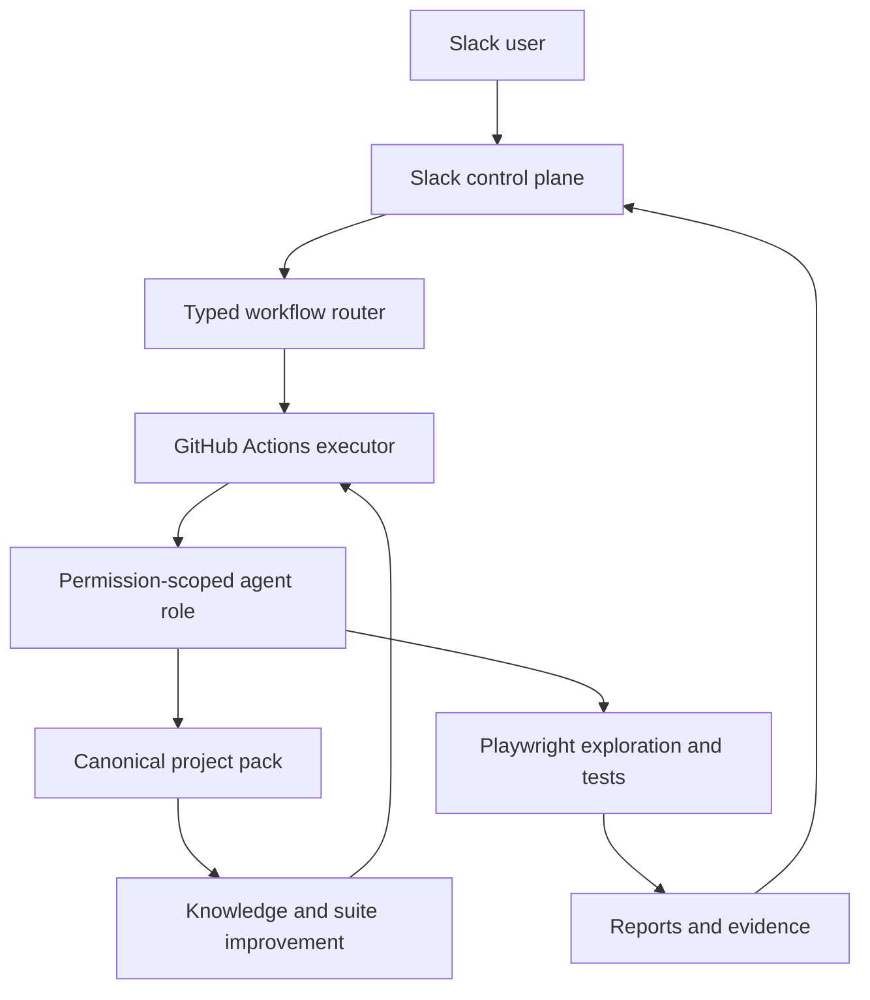

# Qali MVP Scaffold Plan

> Authoritative implementation plan. Migrated from the Cursor plan session (Aug 2026). All MVP todos are **completed** as of commit after `42be0aa`. See [origin-context.md](origin-context.md) for product decisions and [roadmap.md](roadmap.md) for next phases.

## Product boundary

Qali is a sibling repository to [qa-garage](../qa-garage) (prototype and migration source). QA Garage stays unchanged.

Qali exposes Slack while hiding its internal skills, role profiles, workflows, tasks, knowledge artifacts, Playwright execution, and maintenance machinery.



## MVP todos (all completed)

| ID                       | Scope                                                | Status |
| ------------------------ | ---------------------------------------------------- | ------ |
| `bootstrap-repo`         | TypeScript workspace and tooling                     | Done   |
| `port-governance`        | QA Garage harness core, skills, policies, validators | Done   |
| `define-workflows`       | Contracts, roles, workflow catalog                   | Done   |
| `build-project-template` | `_template` + `_demo` mock target                    | Done   |
| `build-slack-control`    | Cloudflare Worker, D1, Queue, GitHub dispatch        | Done   |
| `build-agent-execution`  | Cursor CLI, Playwright, GitHub Actions               | Done   |
| `complete-demo-loop`     | Mock Mode vertical slice                             | Done   |
| `document-roadmap`       | External roles, publication, docs                    | Done   |

## Repository structure

TypeScript npm-workspaces monorepo:

- `apps/slack-worker/` — Cloudflare Worker, Queue, D1, Slack/GitHub webhooks.
- `packages/contracts/` — typed commands, events, workflow results and role permissions.
- `packages/orchestrator/` — workflow loading, routing, policy checks and state transitions.
- `packages/knowledge/` — provenance, source ownership, contradiction and derivation logic.
- `packages/agent-runtime/` — runtime port, fake test adapter and Cursor CLI adapter.
- `packages/playwright/` — exploration/test-generation conventions and report parsing.
- `packages/reporting/` — compact Slack cards and expandable details.
- `packages/publication/` — safe auto-commit policy and GitHub adapter.
- `workflows/` — machine-readable workflow definitions.
- `projects/_template/` — reusable target-project architecture.
- `projects/_demo/` — mock target proving the full experience.
- `.github/workflows/` — dispatch, execution, callback and scheduled jobs.

## Selective migration from QA Garage

Migration is selective: durable QA expertise yes; IDE-specific instructions and prototype clutter no.

### Migrated into the MVP

- QA operating model from `qa-garage/core/ai/` → `core/policies/`
- Five thin harness wrappers from `qa-garage/core/skills/` → workflow/role bindings
- MVP vendored skills (see `skills/catalog.json`):
  - `qa-project-context`, `qa-start`, `qa-project-bootstrap`
  - `journey-mapping`, `risk-based-testing`, `test-strategy`, `test-planning`
  - `exploratory-testing`, `agentic-browser-testing`
  - `playwright-automation`, `ai-test-generation`
  - `visual-testing`, `test-data-management`
  - `bug-reproduction`, `ai-bug-triage`
  - `test-reliability`, `selector-drift-recovery`
  - `qa-report-humanizer`
- Templates from `qa-garage/core/templates/` → `core/templates/`
- Project-root concepts from `qa-garage/projects/_template/`
- Tested logic from `qa-garage/scripts/lib/` (context, reference, review gates)
- Playwright defaults and skill lock (`skills/skills-lock.json`)

Skills remain internal. Workflows select them; Slack users never invoke skill names.

### Migrate after the MVP

- `accessibility-testing`, `cross-browser-testing`, `coverage-analysis`, `test-suite-curation`, `release-readiness`, `qa-metrics`, `qa-dashboard`, `shift-left-testing`, `ci-cd-integration`, `api-testing`, `contract-testing`, `database-testing`, `ai-system-testing`, and other specialist skills when their workflows activate.

### Adapt rather than copy verbatim

Key source material:

- `qa-garage/core/ai/qa-principles.md` — deterministic evidence, non-silent failures
- `qa-garage/core/ai/qa-project-context-model.md` — provenance and artifact ownership
- `qa-garage/core/ai/discovery-workflow.md` — docs/app discovery sequence
- `qa-garage/core/ai/knowledge-maintenance.md` — continuous knowledge loop
- `qa-garage/core/ai/test-design-principles.md` — risk, negative paths, assertion sources
- `qa-garage/scripts/lib/review.ts`, `context.ts`, `reference.ts` — port pure logic with tests

Rewrite IDE hats as permission-scoped runtime roles; Markdown procedures as validated workflow YAML; manual tasks/jobs as workflow state and audit events.

Do not copy `postdocs-ai`, placeholder tests, generated evidence, IDE adapters, duplicated read-order instructions, or shallow scaffolding scripts.

## Canonical project template

Three artifact classes under `projects/_template/`:

- `sources/` — governed product facts, requirements, journeys, risks, decisions, autonomy policy. Qali authors by default; humans may edit.
- `observations/` — evidenced app behaviour, exploration findings, failures, contradictions.
- `derived/` — generated strategy, plans, coverage maps, scenarios, reports, indexes. Generated markers; reject direct edits where enforceable.

Playwright tests and visual snapshots live under `tests/`. Every fact records confidence, source, date and evidence. Observation alone cannot silently redefine expected behaviour.

## Internal roles and workflows

Permission-scoped runtime profiles (not free-roaming agents):

- Intake Planner, Knowledge Curator, Test Architect, Explorer, Test Generator, Executor, Failure Analyst, Suite Maintainer, Reporter

Workflow definitions in `workflows/`:

- `project-onboarding.yaml`, `exploratory-testing.yaml`, `generate-test-suite.yaml`, `run-test-suite.yaml`
- `triage-and-reproduce.yaml`, `knowledge-maintenance.yaml`, `suite-maintenance.yaml`, `quality-pulse.yaml`

MVP executes onboarding, exploration, generation, running and reporting.

## External Slack roles

- **Developer** (default) — exploration, generate/run suites, triage, quality pulse
- **QA Lead/Admin** (`SLACK_QA_LEAD_USER_IDS`) — plus maintenance and policy workflows

## Autonomy and self-improvement

Project modes: `conservative`, `balanced`, `autonomous` (demo uses `autonomous`).

Auto-permit: evidence capture, observation append, derived regeneration, equivalent selector repair, approved-scenario test generation, execution, reporting. Controlled publication commits safe changes via `qali/*` PR → auto-merge.

Never auto-permit: assertion weakening, failure hiding, test deletion/skip, visual-baseline replacement, observed-bug promotion without authority.

Audit: Git history + D1 correlation + workflow state JSONL.

## Two-day MVP execution (completed)

### Day 1 — foundation and control-plane tracer bullet

- Repository, workspace, lint/type/test tooling, mock-mode convention
- Harness policies, wrapper skills, MVP skill subset, templates, skill lock
- Governance/provenance primitives (TDD)
- Typed Slack intents and workflow contracts
- Signed Slack ingestion, dedupe, Queue, D1, GitHub App dispatch and callback

### Day 2 — autonomous QA vertical slices

- `_template` and `_demo` with `[MOCK MODE]`
- Free-form routing → explore → generate → run → report
- GitHub Actions execution, artifact upload, compact Slack cards
- Controlled publication scaffold
- Full demo sequence verified locally

## TDD and verification strategy

One observable vertical behavior at a time; commit after each green slice.

- Contract, unit, worker integration, workflow YAML, agent eval, Playwright E2E tests
- End-to-end smoke (live Slack → GHA → demo → Slack) — **not yet deployed**

Verified locally:

```bash
npm run check
npm run demo:test
npm run demo:loop
npm run project:validate -- projects/_demo
```

## Follow-on roadmap

See [roadmap.md](roadmap.md). Summary:

1. Harden retries, dead-letter, rate limits, secrets, retention, allowlists
2. Complete self-maintenance, flake eval, selector repair, rollback
3. Richer QA Lead policy editing and quality pulse
4. Multi-project isolation and onboarding UX
5. PR-preview testing when available; scope recommendations when not
6. Linear/PostHog (lower priority)
7. Accessibility, cross-browser, release-readiness, shift-left

## Acceptance criteria

- [x] Free-form Slack request without knowing Qali internals (scaffold + Mock Mode)
- [x] Explicit versioned workflow selection
- [x] Autonomous explore → knowledge → generate → run → report on demo
- [x] Slack essentials + expandable detail (reporting package)
- [x] Traceability to workflow state, knowledge, run, evidence
- [x] Safe publication policy; semantic weakening blocked
- [x] Generic project template, no startup-specific assumptions
- [ ] Live Slack + Cloudflare + GitHub deployment (Phase 2)
