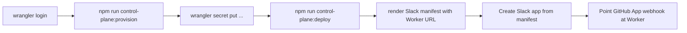

# Cloudflare control plane setup

Qali’s Slack intake runs on a **Cloudflare Worker** with **D1** (correlation), **Queues** (async dispatch), and **Workers AI** (intent classification).

Live deploy has not been run from the authoring environment. This guide is the operator path from a clean Cloudflare account to a reachable Worker URL.

## What gets provisioned

| Resource   | Name / binding                           | Purpose                                            |
| ---------- | ---------------------------------------- | -------------------------------------------------- |
| Worker     | `qali-slack-control`                     | HTTP endpoints for Slack + GitHub webhooks         |
| D1         | `qali-control` → binding `DB`            | Dedup + request/run correlation                    |
| Queue      | `qali-inbound` → binding `INBOUND_QUEUE` | Durable handoff from intake to classifier/dispatch |
| Workers AI | binding `AI`                             | Free-form → normalized intent                      |

Config source of truth: `apps/slack-worker/wrangler.jsonc`.

## Prerequisites

1. A Cloudflare account (free tier is enough for MVP experiments).
2. Node.js 22+ and repo dependencies (`npm ci` from the monorepo root).
3. Wrangler auth:

```bash
npx wrangler login
npx wrangler whoami
```

## Recommended order



Slack URL verification requires a live Worker, so **deploy Cloudflare before finishing the Slack app manifest URLs**.

## Automated provision

From the monorepo root:

```bash
# Creates D1 + Queue, patches wrangler.jsonc database_id, applies migrations,
# and renders apps/slack-worker/slack-app-manifest.local.json when .env has Worker URL vars
npm run control-plane:provision

# Preview commands without remote mutations
npm run control-plane:provision -- --dry-run
```

What the script does:

1. `wrangler d1 create qali-control` (skipped if `database_id` is already set)
2. Writes the returned UUID into `apps/slack-worker/wrangler.jsonc`
3. `wrangler queues create qali-inbound` (ignores “already exists”)
4. `wrangler d1 migrations apply qali-control --remote`
5. Renders `apps/slack-worker/slack-app-manifest.local.json` from the generic template + `.env` Worker URL (skips if URL vars are missing)

Manual equivalent if you prefer the dashboard:

1. Workers & Pages → Create application → Worker → name `qali-slack-control`
2. D1 → Create database `qali-control` → copy UUID into `wrangler.jsonc` `database_id`
3. Queues → Create queue `qali-inbound`
4. Ensure Workers AI is available on the account (default for most accounts)

## Secrets and vars

Non-secret defaults live in `wrangler.jsonc` `vars` (`GITHUB_WORKFLOW_FILE`, allowlist placeholders).

Fill [`.env`](../.env.example) locally (copy from `.env.example`), then sync:

```bash
# Slack only
npm run control-plane:sync-secrets -- --only slack

# GitHub App dispatch credentials only
npm run control-plane:sync-secrets -- --only github

# Every non-empty Worker secret in .env
npm run control-plane:sync-secrets

# Preview which keys would be uploaded
npm run control-plane:sync-secrets -- --dry-run
```

Manual equivalent (stdin per secret):

```bash
npx wrangler secret put SLACK_SIGNING_SECRET --config apps/slack-worker/wrangler.jsonc
# ... same for SLACK_BOT_TOKEN, SLACK_BOT_USER_ID, and GitHub keys
```

Optional role / allowlist configuration (plain `vars` in `wrangler.jsonc`, or secrets):

- `SLACK_ALLOWED_TEAM_IDS`
- `SLACK_ALLOWED_CHANNEL_IDS`
- `SLACK_ALLOWED_USER_IDS`
- `SLACK_QA_LEAD_USER_IDS`

`GITHUB_WORKFLOW_FILE` defaults to `execute.yml` in config — keep it aligned with `.github/workflows/execute.yml`.

## Deploy

```bash
npm run control-plane:deploy
# equivalent: npx wrangler deploy --config apps/slack-worker/wrangler.jsonc
```

After deploy, note the Worker URL:

```text
https://qali-slack-control.<your-subdomain>.workers.dev
```

Endpoints:

| Path                  | Consumer                          |
| --------------------- | --------------------------------- |
| `/slack/events`       | Slack Events API                  |
| `/slack/interactions` | Slack interactivity               |
| `/github/webhook`     | GitHub App `workflow_run` webhook |

Validate packaging without credentials:

```bash
npm run control-plane:dry-run
```

## Render Slack manifest for your Worker URL

Fill `.env` (preferred) or export env vars, then:

```bash
# reads WORKER_BASE_URL or CLOUDFLARE_WORKERS_SUBDOMAIN from .env
npm run control-plane:render-slack-manifest
```

That writes gitignored `apps/slack-worker/slack-app-manifest.local.json` and leaves the committed template generic.

Overrides without editing `.env`:

```bash
WORKER_BASE_URL=https://qali-slack-control.<your-subdomain>.workers.dev \
  npm run control-plane:render-slack-manifest

CLOUDFLARE_WORKERS_SUBDOMAIN=<your-subdomain> \
  npm run control-plane:render-slack-manifest
```

Then follow [setup-slack.md](setup-slack.md) (create app from the local manifest).

## Local development

```bash
npm run control-plane:dev
# equivalent: npx wrangler dev --config apps/slack-worker/wrangler.jsonc
```

`wrangler dev` binds local D1/Queue emulators. Slack signature verification still needs real secrets and a public tunnel (e.g. Cloudflare Tunnel / ngrok) if you want live Slack events against local code.

Unit tests for the Worker do **not** require Cloudflare — they run under Vitest with fakes (`npm run check`).

## Cost and retention

| Resource         | MVP expectation                                        |
| ---------------- | ------------------------------------------------------ |
| Workers requests | Free tier usually enough for Slack traffic             |
| Queues           | Low volume; watch free-tier message limits             |
| D1               | Correlation rows; prune after ~90 days (manual in MVP) |
| Workers AI       | Intent classification; monitor free-tier tokens        |

Artifact retention for GitHub Actions is separate (14 days in `execute.yml`).

## Troubleshooting

| Symptom                         | Check                                                                   |
| ------------------------------- | ----------------------------------------------------------------------- |
| `database_id` still placeholder | Re-run `npm run control-plane:provision` or paste UUID from dashboard   |
| Queue binding errors on deploy  | Confirm queue name is exactly `qali-inbound`                            |
| AI binding missing              | Workers AI enabled on account; `ai.binding` present in `wrangler.jsonc` |
| Slack URL verification fails    | Worker must be deployed and returning 200 to Slack challenge            |
| Secrets not found at runtime    | Set via `wrangler secret put`, not only `.env` locally                  |
| Auth errors from Wrangler       | `npx wrangler login` / correct Cloudflare account                       |

## Related docs

- [setup-slack.md](setup-slack.md) — Slack app manifest install + roles
- [setup-github.md](setup-github.md) — GitHub App + publication token
- [architecture.md](architecture.md) — control vs execution plane
